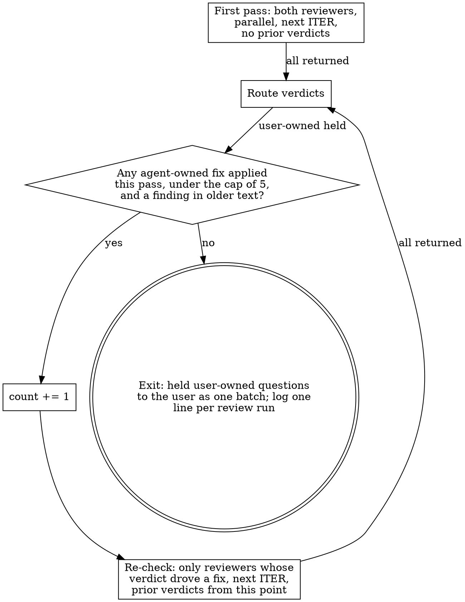

# Brainstorming Process Flow

The control graph for `brainstorming/SKILL.md`. `## The flow` in that file and
[review-loop.md](review-loop.md) are authoritative; these graphs are the same flow drawn, for when the branch structure is
easier to see than to read.

```dot
digraph brainstorming {
    "Settle ticket, then lens\n(ticket question alone first;\nlens question only when\nthe ticket records none)" [shape=box];
    "Researcher read\n(or direct investigation)" [shape=box];
    "Sweep: comb over the files\nthe design will touch;\nask the joins; merges / closes\napplied on a lane, asked off one" [shape=box];
    "Init artifact set\n(idea + changelog + process-notes)\nor adopt existing idea.md\nwrite **Ticket:** either way\n(own ticket first, then the swept)" [shape=box];
    "Draft ## Architecture on the lens\n+ ### Agent judgments\n(kept as is when adopted\nidea.md already has one)" [shape=box];
    "Gate: review loop\non ## Architecture" [shape=box];
    "Short message to the user:\nshape, judgments, fixes,\nheld questions" [shape=box];
    "Dialogue\n(walks ## Architecture top down;\nidea.md + changelog.md\nupdated as decisions land)" [shape=box];
    "Batch final?\n(nothing pending, rulings written,\nOpen Questions empty)" [shape=diamond];
    "Closing review: review loop\non the finished document\n(fix count reset)" [shape=box];
    "Held questions?" [shape=diamond];
    "One question batch to the user" [shape=box];
    "Any ruling changed idea.md?" [shape=diamond];
    "Boundary ingest, drift only\n(no-op when no drift pending)" [shape=box];
    "User reviews idea.md\n(git -C scratch diff)" [shape=diamond];
    "Commit the wiki-path set\n(on a lane: committed;\noff a lane: offered;\nonly when that set is non-empty)" [shape=box];
    "/implement-code {project}" [shape=doublecircle];

    "Settle ticket, then lens\n(ticket question alone first;\nlens question only when\nthe ticket records none)" -> "Researcher read\n(or direct investigation)";
    "Researcher read\n(or direct investigation)" -> "Sweep: comb over the files\nthe design will touch;\nask the joins; merges / closes\napplied on a lane, asked off one";
    "Sweep: comb over the files\nthe design will touch;\nask the joins; merges / closes\napplied on a lane, asked off one" -> "Init artifact set\n(idea + changelog + process-notes)\nor adopt existing idea.md\nwrite **Ticket:** either way\n(own ticket first, then the swept)";
    "Init artifact set\n(idea + changelog + process-notes)\nor adopt existing idea.md\nwrite **Ticket:** either way\n(own ticket first, then the swept)" -> "Draft ## Architecture on the lens\n+ ### Agent judgments\n(kept as is when adopted\nidea.md already has one)";
    "Draft ## Architecture on the lens\n+ ### Agent judgments\n(kept as is when adopted\nidea.md already has one)" -> "Gate: review loop\non ## Architecture";
    "Gate: review loop\non ## Architecture" -> "Short message to the user:\nshape, judgments, fixes,\nheld questions" [label="loop exited"];
    "Short message to the user:\nshape, judgments, fixes,\nheld questions" -> "Dialogue\n(walks ## Architecture top down;\nidea.md + changelog.md\nupdated as decisions land)";
    "Dialogue\n(walks ## Architecture top down;\nidea.md + changelog.md\nupdated as decisions land)" -> "Batch final?\n(nothing pending, rulings written,\nOpen Questions empty)";
    "Batch final?\n(nothing pending, rulings written,\nOpen Questions empty)" -> "Dialogue\n(walks ## Architecture top down;\nidea.md + changelog.md\nupdated as decisions land)" [label="no"];
    "Batch final?\n(nothing pending, rulings written,\nOpen Questions empty)" -> "Closing review: review loop\non the finished document\n(fix count reset)" [label="yes"];
    "Closing review: review loop\non the finished document\n(fix count reset)" -> "Held questions?" [label="loop exited"];
    "Held questions?" -> "One question batch to the user" [label="yes"];
    "Held questions?" -> "Boundary ingest, drift only\n(no-op when no drift pending)" [label="none"];
    "One question batch to the user" -> "Any ruling changed idea.md?";
    "Any ruling changed idea.md?" -> "Dialogue\n(walks ## Architecture top down;\nidea.md + changelog.md\nupdated as decisions land)" [label="yes: apply,\nnew review point"];
    "Any ruling changed idea.md?" -> "Boundary ingest, drift only\n(no-op when no drift pending)" [label="no: my ruling stands"];
    "Boundary ingest, drift only\n(no-op when no drift pending)" -> "User reviews idea.md\n(git -C scratch diff)";
    "User reviews idea.md\n(git -C scratch diff)" -> "Dialogue\n(walks ## Architecture top down;\nidea.md + changelog.md\nupdated as decisions land)" [label="changes requested"];
    "User reviews idea.md\n(git -C scratch diff)" -> "Commit the wiki-path set\n(on a lane: committed;\noff a lane: offered;\nonly when that set is non-empty)" [label="approved"];
    "Commit the wiki-path set\n(on a lane: committed;\noff a lane: offered;\nonly when that set is non-empty)" -> "Build point\n(lane-methodology\nWhen a lane opens)" [label="committed or declined"];
    "Build point\n(lane-methodology\nWhen a lane opens)" -> "/implement-code {project}" [label="on a lane"];
}
```

## The review loop

Run at every review point: the gate, the closing review, and every return to the closing review.
Each point starts at the first pass with the fix-pass count at 0.

